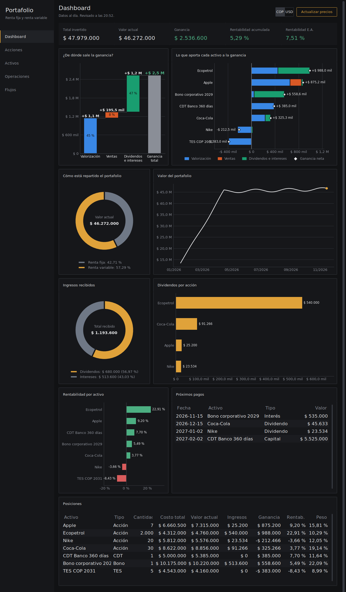
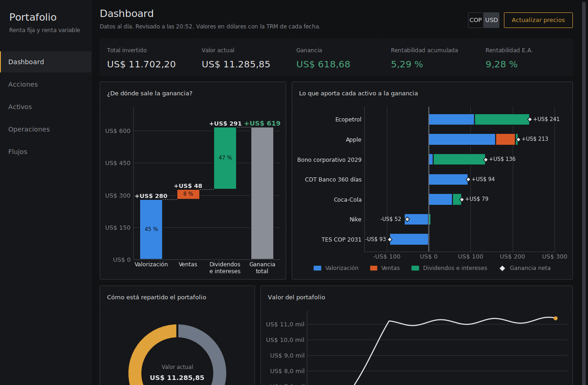
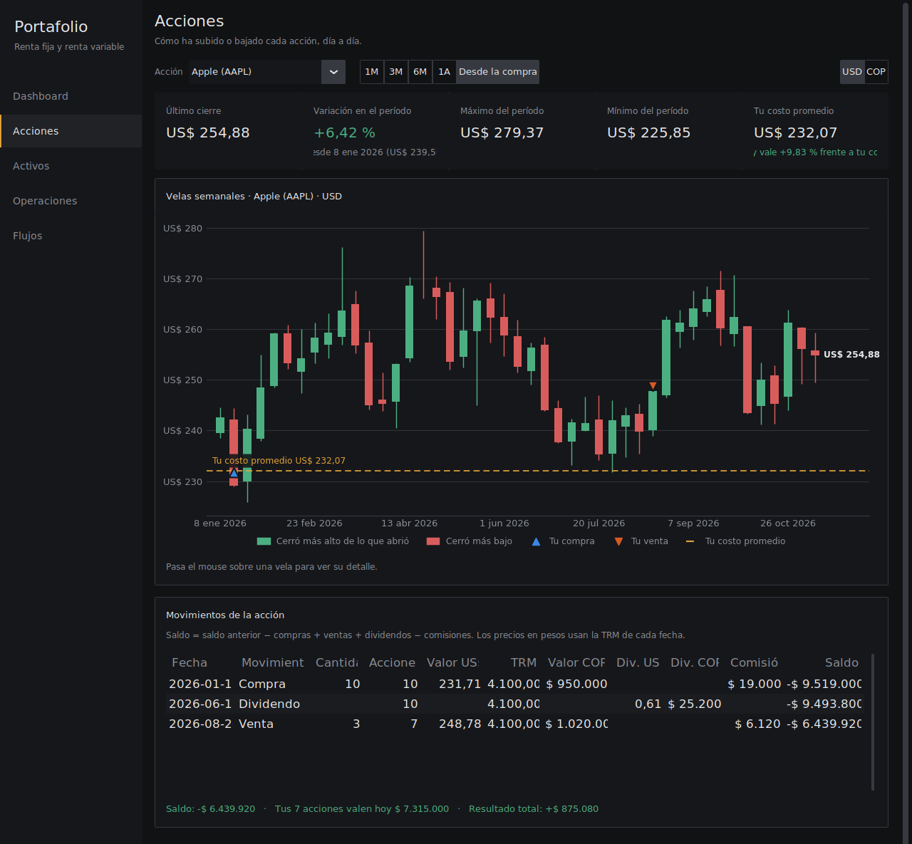
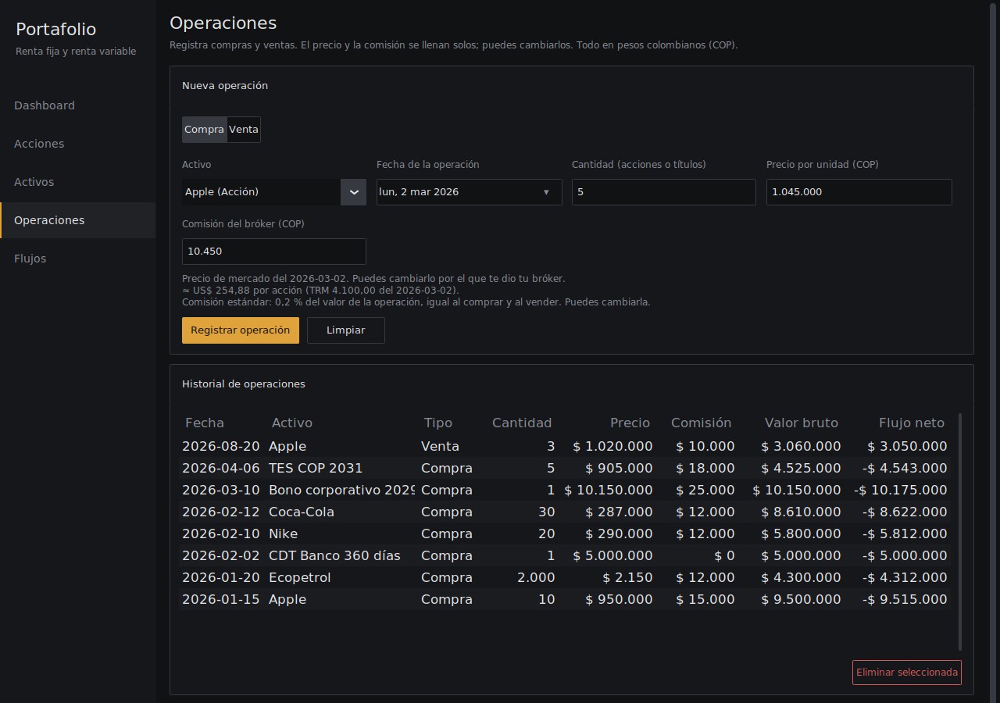
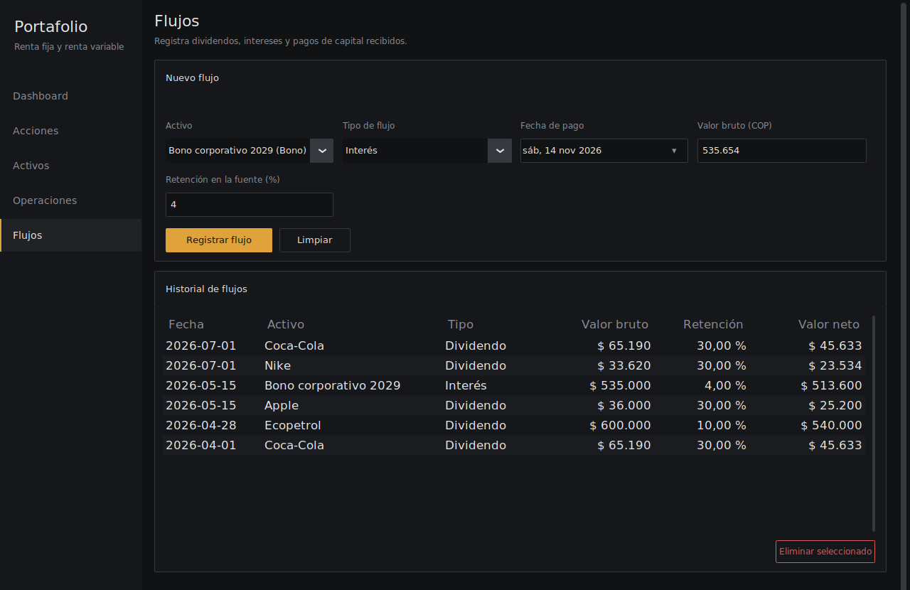

# Seguimiento de portafolio de inversión

Aplicación de escritorio en Python para llevar el seguimiento de un portafolio con **renta variable** (acciones) y **renta fija** (CDT, bonos y TES). Registra compras y ventas, dividendos, intereses y pagos de capital; valora cada activo a precio de mercado o según sus condiciones contractuales, y calcula la **rentabilidad acumulada**, la **rentabilidad efectiva anual (E.A.)**, el valor invertido, el valor actual y de dónde sale la ganancia. Todo se puede ver en **pesos (COP) o en dólares (USD)**.

Proyecto de la asignatura **Estructura de datos** (Entrega 3), hecho en equipo por tres integrantes.



## Qué hace la aplicación

- **Dashboard:** indicadores (total invertido, valor actual, ganancia, rentabilidad acumulada y E.A.), cómo está repartido el portafolio, **de dónde sale la ganancia** (valorización, ventas, dividendos e intereses, en total y por activo), ingresos recibidos, dividendos por acción, rentabilidad por activo, próximos pagos y la tabla de posiciones con el peso de cada activo. Un selector **COP / USD** cambia todo el tablero a dólares, convirtiendo cada movimiento con la TRM de su fecha.
- **Acciones:** gráfica de **velas japonesas** de cada acción, con tus compras y ventas marcadas, tu costo promedio y el extracto de movimientos fila por fila.
- **Activos:** crea acciones (con su ticker de Yahoo Finance y su moneda), CDT, bonos y TES (con valor nominal, tasa E.A., fechas, periodicidad de pago y tasa de mercado).
- **Operaciones:** registra compras y ventas. La fecha se elige en un **calendario desplegable**, y el **precio** (de mercado de ese día) y la **comisión** (0,2 % del valor, tarifa estándar) se llenan solos, aunque se pueden cambiar. No deja vender más de lo que se tiene.
- **Flujos de caja:** registra dividendos (acciones) e intereses, pagos de capital u otros ingresos (renta fija), con su retención en la fuente.
- Los datos se guardan en una base SQLite local (`portafolio.db`). Los precios se consultan con `yfinance`.

## Capturas

| Dashboard en dólares | Acciones (velas japonesas) |
|---|---|
|  |  |

| Operaciones: precio y comisión automáticos | Flujos de caja |
|---|---|
|  |  |

> Las capturas usan datos de ejemplo.

## Requisitos

- **Python 3.11 o superior** (en Windows, el lanzador `py`).
- **Git**, para clonar el repositorio.
- **Conexión a internet** para traer precios reales y la TRM. Sin internet la aplicación abre igual, pero sin precios actualizados. La opción `--mock` no necesita conexión.
- Las librerías están en `requirements.txt`: `customtkinter`, `matplotlib`, `pandas`, `yfinance`, `scipy` y `pylint`. SQLite viene con Python.

## Instalación

En Windows, desde PowerShell:

```powershell
git clone https://github.com/cristophh07-dot/Entrega3_Estructura_de_datos.git
cd Entrega3_Estructura_de_datos

py -m venv .venv
.venv\Scripts\activate
py -m pip install -r requirements.txt
```

Si PowerShell no deja activar el entorno por la política de scripts, ejecuta una sola vez `Set-ExecutionPolicy -Scope CurrentUser RemoteSigned` y vuelve a activarlo.

## Cómo ejecutar

```powershell
py main.py
```

Abre la aplicación con la base de datos `portafolio.db`, que se crea sola la primera vez. Queda lista para registrar activos y operaciones.

```powershell
py main.py --cargar-ejemplo
```

Abre la aplicación y, si la base está vacía, la llena con un portafolio de ejemplo (acciones, CDT, bono y TES con sus operaciones y flujos). Es la forma más rápida de ver el programa funcionando. Necesita internet para traer los precios reales.

```powershell
py main.py --mock
```

Abre la aplicación con datos falsos en memoria, sin base de datos ni internet. Sirve para probar la interfaz.

### Pruebas

```powershell
py -m unittest discover -s tests -t . -v
```

## Estructura de carpetas

```text
Entrega3_Estructura_de_datos/
├── main.py                  # único punto de entrada
├── requirements.txt
├── modelos/                 # clases del dominio
│   ├── activo.py            #   Activo (abstracta)
│   ├── accion.py            #   Accion
│   ├── renta_fija.py        #   RentaFija (abstracta)
│   ├── cdt.py  bono.py  tes.py
│   ├── operacion.py         #   Operacion (compra o venta)
│   └── flujo_caja.py        #   FlujoCaja (dividendo, interés, capital)
├── datos/                   # persistencia y precios
│   ├── repositorio.py       #   Repositorio (SQLite)
│   ├── servicio_precios.py  #   ServicioPrecios (precios y TRM con yfinance)
│   └── servicio_velas.py    #   ServicioVelas (velas diarias de cada acción)
├── motor/                   # cálculos
│   ├── posicion.py                    # costo promedio ponderado
│   ├── valorador_renta_variable.py
│   ├── valorador_renta_fija.py
│   ├── generador_flujos.py            # calendario de pagos
│   ├── calculadora_rentabilidad.py    # rentabilidad acumulada y E.A. (XIRR)
│   ├── conversor_moneda.py            # COP a USD con la TRM de cada fecha
│   ├── comision_broker.py             # comisión sugerida (0,2 %)
│   ├── extracto_movimientos.py        # movimientos de un activo con su saldo
│   ├── historial_accion.py            # datos de la gráfica de velas
│   ├── cargador_ejemplo.py
│   └── portafolio.py                  # consolida todo para la interfaz
├── interfaz/                # pantallas (CustomTkinter + matplotlib)
│   ├── tema.py  tabla_datos.py  selector_fecha.py  ventana_principal.py
│   ├── vista_base.py        #   VistaBase (abstracta)
│   ├── vista_dashboard.py  vista_acciones.py
│   └── vista_activos.py  vista_operaciones.py  vista_flujos.py
├── mocks/                   # versiones falsas para trabajar sin esperar al resto
├── tests/                   # pruebas unitarias
└── docs/
    ├── uml/                 # diagramas UML
    └── capturas/            # capturas de pantalla de este README
```

Cada archivo contiene una sola clase y se llama como ella en `snake_case` (por ejemplo, `Portafolio` está en `portafolio.py`).

## Cómo está organizado

La aplicación tiene cuatro capas, y cada una solo usa a las anteriores:

1. **`modelos/`** define qué es un activo, una operación y un flujo, y valida sus datos.
2. **`datos/`** guarda y lee esos objetos (SQLite) y consulta precios (yfinance).
3. **`motor/`** valora, genera flujos y calcula la rentabilidad. `Portafolio` es la fachada que usa la interfaz.
4. **`interfaz/`** muestra los resultados y recibe los datos del usuario.

Reglas comunes: el dinero se guarda en pesos colombianos (COP), las tasas son efectivas anuales en decimal (`0.12` = 12 %), la base es de 365 días y las fechas son `datetime.date`.

Hay más detalle (arquitectura, manual de uso, fórmulas y flujo de Git) en la [wiki del proyecto](../../wiki).

## Integrantes

| Integrante | Responsabilidad | GitHub |
|---|---|---|
| Cristopher | Motor de cálculo (`motor/`), `main.py` y administración del repositorio | [@cristophh07-dot](https://github.com/cristophh07-dot) |
| Josué | Modelos (`modelos/`), datos (`datos/`) y diagramas UML (`docs/uml/`) | [@josuetamayo1](https://github.com/josuetamayo1) |
| Johan | Interfaz gráfica (`interfaz/`), README y wiki | [@jhoanpro321-ux](https://github.com/jhoanpro321-ux) |

## Flujo de trabajo en Git

- `main`: solo entregas. `develop`: integración.
- Cada cambio se hace en una rama propia (`feature/...`, `docs/...`, `fix/...`) creada desde `develop`.
- Nadie sube directo a `main` ni a `develop`: todo entra por Pull Request a `develop`, revisado por otro integrante.
- Commits pequeños y frecuentes con prefijo: `feat:`, `fix:`, `docs:`, `test:`, `refactor:`.
